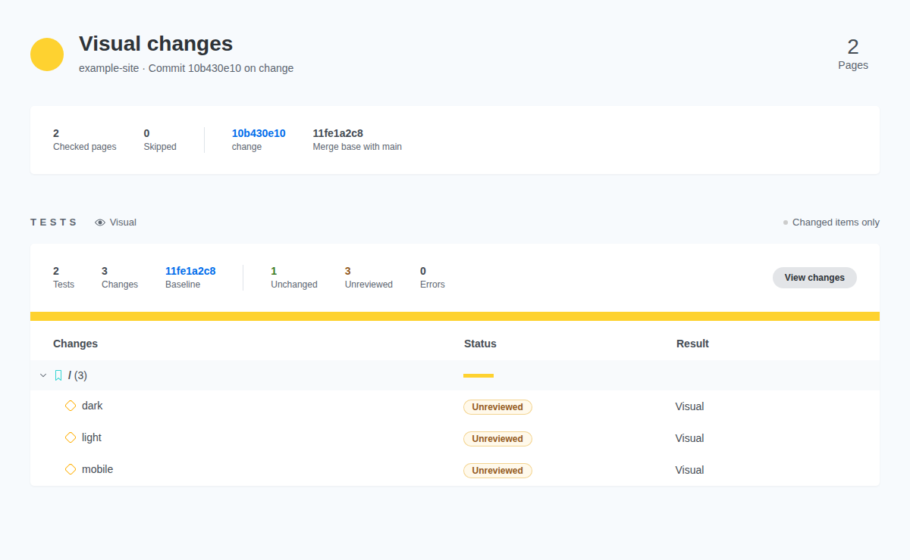
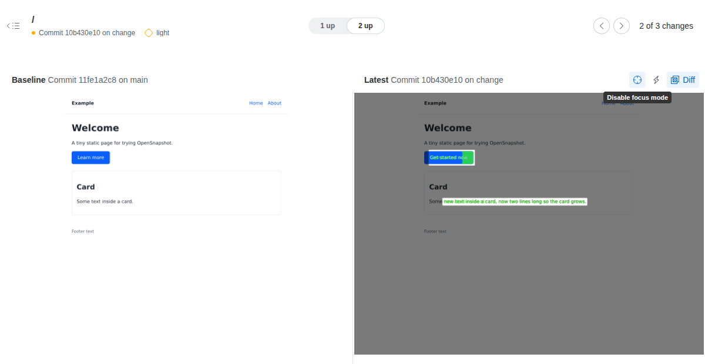
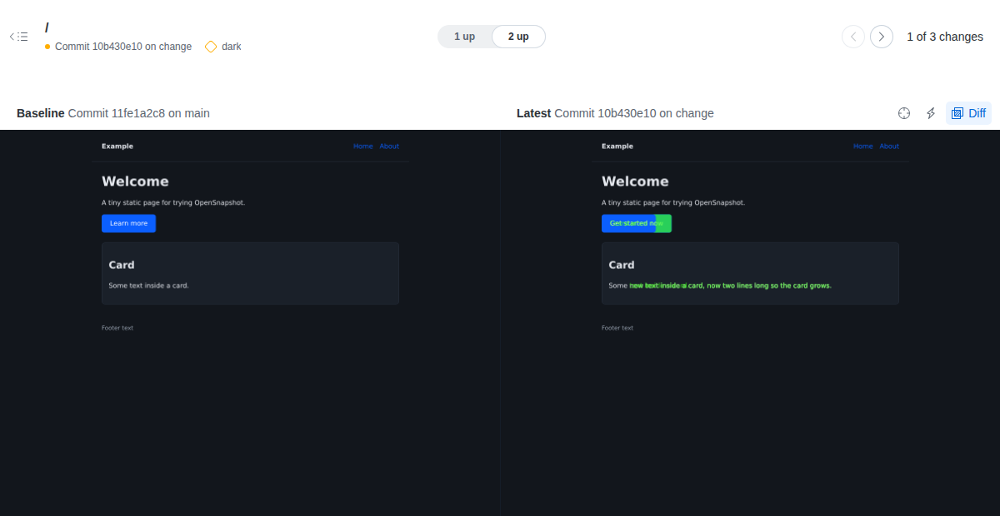
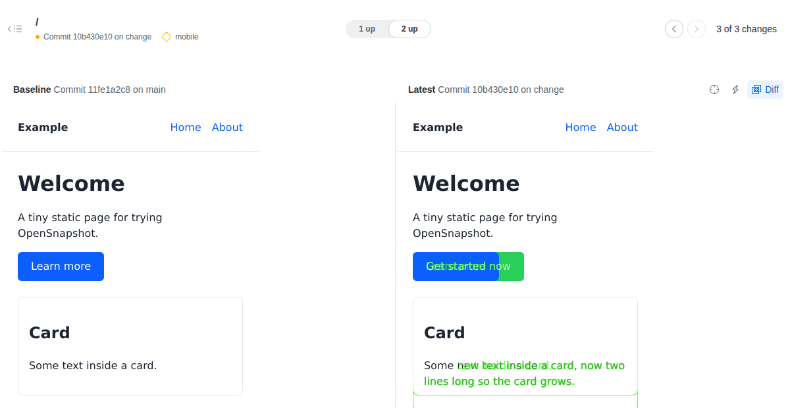
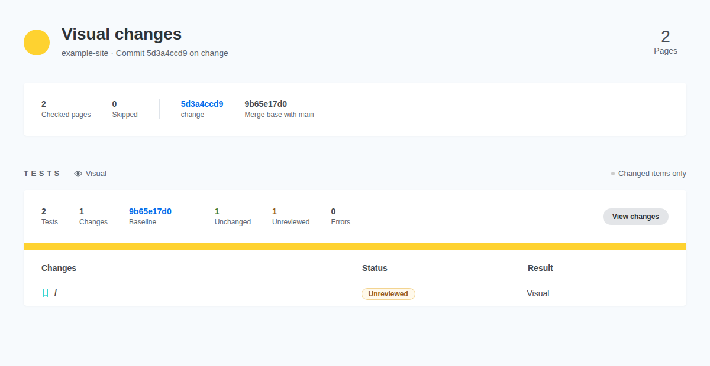
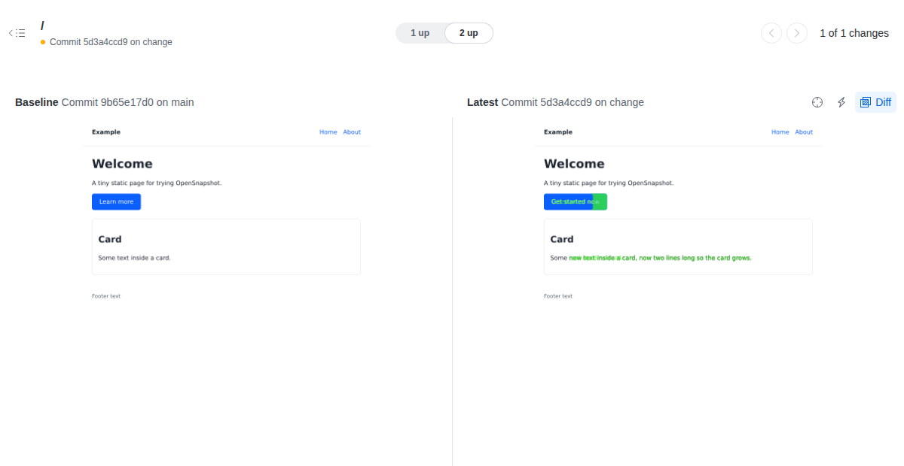
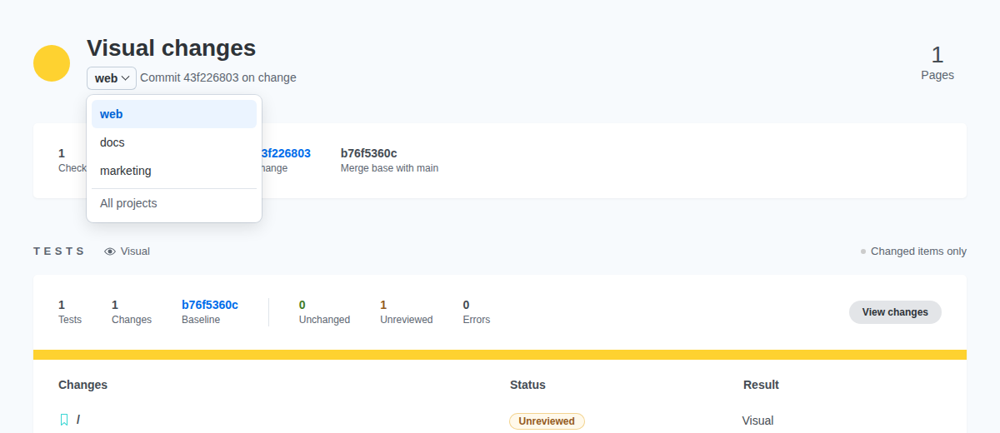
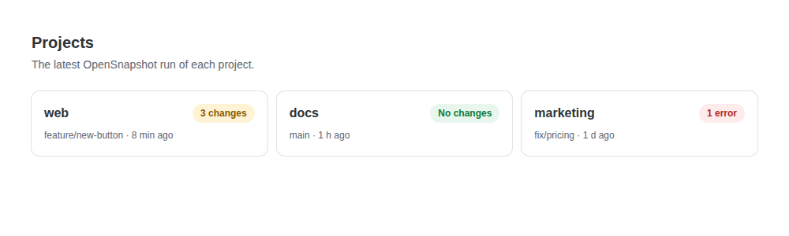

# OpenSnapshot

Visual diff for Storybook and static sites. OpenSnapshot builds your base branch and your change, screenshots both with Playwright, and writes a static review page that shows **only what changed**: baseline, latest and a diff overlay, side by side.

- **No account, no service, no baseline files in git.** The baseline is rebuilt from the merge base on every run, on the same machine that renders the change. Fonts and browser versions cancel out.
- **Runs the same way everywhere.** `opensnapshot run` locally, or the bundled GitHub Action in CI.
- **Modes are optional.** Use many themes and viewports, or none at all and get a plain "before versus after" diff.
- **The output is a folder.** Zip it, upload it as a CI artifact, or deploy it to any static host.

## Why

A pull request changes CSS, a component or a design token, and nobody sees what moved on the pages that share it. Hosted visual-testing tools solve that, but they add an account, a baseline to approve and a per-snapshot bill. OpenSnapshot keeps the part that matters in review (what changed, shown next to what it was) and drops the rest.

## Demo

Everything below comes from the fixture in [`examples/static-site`](examples/static-site): a two-page site where one commit changes the home page's button label and card text. Regenerate the images with `pnpm docs:images`.

### Overview: only what changed

The About page did not change, so it is not listed. The home page is listed once per mode (light, dark and mobile).



### One changed item: baseline, latest and diff

Left is the merge base, right is your change. The green overlay marks every pixel that differs.


Focus mode dims everything except the areas that changed. Strobe mode flips the overlay so small shifts catch the eye. `1 up` shows one image at a time, and the arrow keys or `j`/`k` move between changes.



### Several modes: themes and viewports

Each mode is one more screenshot of the same page. This one is the dark theme (`colorScheme: "dark"`); the chip next to the commit names the mode.



A phone-width mode catches layout problems the desktop view hides.



### No modes: a plain baseline versus change diff

Leave `modes` out of the config and every page is shot once, at 1200 by 900 with no theme. The review page then shows no mode column and no mode chip.





## Quick start (local)

You need Node 20.11 or later, git, and the history of the branch you compare with (`origin/main` by default).

The package is not on npm yet. Until it is, clone this repository, run `pnpm install && pnpm build`, and call `node /path/to/OpenSnapshot/dist/cli.js` from your project. A config that imports `opensnapshot` still resolves. Once published:

```bash
pnpm add -D opensnapshot             # or run it without installing: pnpm dlx opensnapshot run
pnpm exec opensnapshot install       # downloads Chromium once (add --with-deps on a fresh Linux machine)
```

**1. Add `opensnapshot.config.ts`** next to your `package.json`.

Storybook:

```ts
import { defineConfig } from "opensnapshot";

export default defineConfig({
    build: { command: "pnpm storybook build -o storybook-static", output: "storybook-static" },
    source: { type: "storybook" },
    // Optional. Leave `modes` out to shoot each story once.
    modes: {
        light: { viewport: 1200 },
        dark: { viewport: 1200, globals: { theme: "dark" } },
        mobile: { viewport: { width: 390, height: 800 } },
    },
});
```

Any static site (a built folder, or plain HTML):

```ts
export default defineConfig({
    build: { command: "pnpm build", output: "dist" }, // leave `command` out to serve `output` as it is
    source: { type: "urls", pages: ["/", "/pricing/", { name: "docs", path: "/docs/intro.html" }] },
});
```

**2. Ignore the work folder:** add `.opensnapshot` to `.gitignore`.

**3. Run it** on a branch with a change:

```bash
pnpm exec opensnapshot run                      # compares with origin/main
pnpm exec opensnapshot run --base origin/develop
pnpm exec opensnapshot review                   # serves the review page on http://localhost:6106
```

Open `.opensnapshot/review/index.html` (it also works from `file://`). Uncommitted edits in your working tree are part of the head build, so you can check a change before you commit it. The first run on a branch with no difference reports "No visual changes", which is the expected result.

## How the base build and the head build work

`opensnapshot run` is one pipeline:

1. **Resolve refs.** It finds the merge base of `--base` and `HEAD`. In a pull request this is the tip of the target branch.
2. **Head build.** It runs `build.command` in your project and serves `build.output`. It lists the items: for Storybook every story in `index.json` (docs entries are skipped), for URLs the pages you configured.
3. **Base build.** It adds a temporary git worktree of the merge base in `.opensnapshot/base-src`, runs the install command there (guessed from the lockfile, or `install` in the config), runs `build.command`, copies `build.output` to `.opensnapshot/base`, and removes the worktree. In a monorepo the commands run in the same sub-folder as your project.
4. **Base pass.** It serves the base build on `127.0.0.1` and takes a Playwright `toHaveScreenshot` shot of every item and mode, recording them as the baseline. An item that cannot render in the base (a story or page the change adds, a 404) simply has no baseline.
5. **Head pass.** It serves the head build and compares each shot with the baseline. An item with no baseline is **new**. A shot that differs is **changed**. A shot that matches counts as **unchanged**, and leaves no image behind. A page that fails to load or a story that throws is an **error**.
6. **Report.** It writes `.opensnapshot/review/index.html` with only the changed and new items, plus `summary.json` and `summary.md`.

The config file comes from your head checkout and applies to both passes, so a change that adds a page and lists it in the config shows that page as new.

Output layout:

```
.opensnapshot/
  review/index.html      the page; open it, zip it or deploy it as it is
  review/img/<item>/     expected, actual, diff and overlay images for changed items
  summary.json           { changed, new, unchanged, skipped, errors }
  summary.md             the text used for the job summary and the PR comment
  base/ baseline/ test-results/ manifest.json   working files
```

## CI with GitHub Actions

The repository ships a composite action ([`action.yml`](action.yml)). Set it up in four steps.

**1. Create the workflow.** Copy [`examples/github-workflow.yml`](examples/github-workflow.yml) to `.github/workflows/visual-diff.yml`:

```yaml
name: Visual diff
on:
  pull_request:

permissions:
  contents: read
  pull-requests: write # only needed for comment: true

jobs:
  visual:
    runs-on: ubuntu-latest
    steps:
      - uses: actions/checkout@v7
        with:
          fetch-depth: 0 # the merge base needs the history
      - uses: pnpm/action-setup@v6
      - uses: actions/setup-node@v7
        with: { node-version: 22, cache: pnpm }
      - run: pnpm install --frozen-lockfile
      - uses: gustavolbs/OpenSnapshot@main # pin a commit SHA in real use
        with:
          working-directory: . # the folder with opensnapshot.config.ts
```

**2. Keep full history.** `fetch-depth: 0` lets the action find the merge base. If the clone is shallow, the action tries to unshallow it and fetch the base branch, and prints a warning if it cannot.

**3. Read the result.** The action writes the counts to the job summary and uploads `.opensnapshot/review` as an artifact named `opensnapshot-review` (14 days). Download and unzip it, then open `index.html`. The artifact is uploaded even when the run fails, so you can see an error page too.

**4. Optionally comment on the pull request.** Set `comment: true` and give the job `pull-requests: write`. The action creates one comment with the counts and a link to the artifact, and updates it on every push instead of adding a new one. The step is off by default and never fails the job (forks get a read-only token).

What the action does for you: installs its own dependencies, caches the Playwright browser per Playwright version, installs Chromium with system dependencies, runs `opensnapshot run --base origin/<PR base branch>` in the working directory, then uploads, summarizes and comments.

| Input | Default | Meaning |
| --- | --- | --- |
| `working-directory` | `.` | Folder with `opensnapshot.config.ts`. |
| `base-ref` | `origin/<PR base>`, else `origin/main` | Ref to compare with. |
| `config` | | Config path, if it has another name. |
| `fail-on-changes` | `false` | Fail the step when something changed. Errors always fail it. |
| `comment` | `false` | Post or update the pull request comment. |
| `github-token` | `github.token` | Token used for the comment. |
| `artifact-name` | `opensnapshot-review` | Artifact name. Use one per project when a repository has several. |
| `retention-days` | `14` | Days to keep the artifact. |

Outputs: `changed`, `new`, `errors`, `artifact-url`.

Other CI systems work too: install Node and your dependencies, run `pnpm exec opensnapshot install --with-deps` and `pnpm exec opensnapshot run`, keep `.opensnapshot/review` as a build artifact, and make sure the clone has full history.

The action is built from this repository on every run. Because the repository is private, GitHub only lets other repositories use it after you open Settings, Actions, General, Access, and allow access from repositories you own.

### Several projects in one company

Give each project its own config with a `name`. The name shows on the review page and in the PR comment, so reviews from different apps do not look alike.

```ts
export default defineConfig({ name: "web", /* ... */ });
```

In a monorepo, add one job (or a matrix entry) per app with its own `working-directory` and `artifact-name`. Each project name gets its own PR comment, updated in place, so several apps in one pull request do not overwrite each other.

### Project selector and the page that lists all projects

List your projects in each config, as `{ name: review URL }`. Use the stable address of each project's Vercel deployment (or any static host that serves the review folder).

```ts
export default defineConfig({
  name: "web",
  projects: { web: "https://web-opensnapshot.vercel.app", docs: "https://docs-opensnapshot.vercel.app" },
  projectsHome: "https://opensnapshot.acme.dev", // optional, adds "All projects"
  /* ... */
});
```

The review page then shows a selector next to the project name. It lists the projects, marks the current one and links to each URL. The links are fixed addresses, so the selector shows no live status.



`opensnapshot index` builds the page behind "All projects". It reads `<url>/summary.json` of every project (the review folder includes that file, with the counts, the head ref and the time of the run) and writes `<outDir>/projects/index.html`: one card per project with "N changes", "No changes", "N errors" or "No data". Deploy that folder to a project of its own and run the command again whenever a project publishes a new review, for example on every merge to the main branch. The addresses must serve the review of the run you want to show, so point them at each project's main-branch deployment.



This part has been exercised with local servers only, not with a real Vercel setup.

### Hosting the review page (optional)

The review folder is static, so any host works. For a team, a good fit is **one Vercel project per app** (for example `web-opensnapshot` and `docs-opensnapshot`): every run becomes one immutable deployment with its own URL, old reviews keep working, and access control is set per project. A single shared project would need a store and a viewer app, because Vercel replaces a whole deployment each time. Suggested step after `opensnapshot run`; this recipe has not been tested yet:

```yaml
- name: Publish the review page
  run: npx vercel deploy .opensnapshot/review --token "$VERCEL_TOKEN" > review-url.txt
  env:
    VERCEL_TOKEN: ${{ secrets.VERCEL_TOKEN }}
    VERCEL_ORG_ID: ${{ secrets.VERCEL_ORG_ID }}
    VERCEL_PROJECT_ID: ${{ secrets.VERCEL_PROJECT_ID }} # the web-opensnapshot project
```

Keep Vercel's deployment protection on if the screenshots are private.

## CLI reference

```
opensnapshot run [--base <ref>] [--config <file>] [--out <dir>] [--fail-on-changes]
opensnapshot review [--out <dir>] [--port <n>] [--config <file>]
opensnapshot index [--config <file>] [--out <dir>]
opensnapshot install [--with-deps] [browser]
opensnapshot help
```

| Command or flag | What it does |
| --- | --- |
| `run` | Runs the pipeline above. Exit code 0 when it finishes with no errors, 1 on errors (or on changes with `--fail-on-changes`), 2 on an unknown command. |
| `--base`, `-b` | Ref to compare with. Overrides `baseRef`. |
| `--config`, `-c` | Config file. Default: `opensnapshot.config.{ts,mts,js,mjs}` in the current folder. |
| `--out`, `-o` | Work folder. Overrides `outDir`. `run` deletes it first. |
| `--fail-on-changes` | Exit 1 when something changed or is new. |
| `review` | Serves `<out>/review` on `http://localhost:<port>` (default: the config's `port`, 6106) until you stop it. |
| `--port`, `-p` | Port for `review`. |
| `index` | Writes the page that lists the config's `projects`, with the latest `summary.json` of each, to `<outDir>/projects` (or `--out`). A project whose summary cannot be read shows "No data". |
| `install` | Installs the Playwright browser that matches the bundled Playwright. Extra arguments go to `playwright install`; the default is `chromium`. |

Run all commands from the folder that holds the config.

## Config reference

`opensnapshot.config.ts` (also `.mts`, `.js`, `.mjs`). `defineConfig` only adds types, and a plain `export default { ... }` works.

| Option | Default | Meaning |
| --- | --- | --- |
| `name` | none | Label for this project on the review page and in the summary. |
| `projects` | none | `{ name: review URL }` of your projects. Adds the project selector to the review page and feeds `opensnapshot index`. |
| `projectsHome` | none | URL of the page `index` built. Adds "All projects" to the selector. |
| `build.output` | required | Folder to serve, relative to the config. |
| `build.command` | none | Builds the site. Runs for the head in the project and for the base in the temporary checkout. Leave it out to serve `output` as it is. |
| `install` | from the lockfile | Install command for the base checkout: `pnpm install --frozen-lockfile`, `yarn install --immutable`, `npm ci` or `bun install --frozen-lockfile`. `false` skips it. |
| `source` | required | `{ type: "storybook", include?, exclude? }` or `{ type: "urls", pages }`. |
| `affected` | off | Storybook only. Shoot only the stories a change can reach. `true` or `{ stats?, always? }`. See below. |
| `modes` | none (one default shot) | Named renderings; each item is shot once per mode. **Optional.** See below. |
| `baseRef` | `origin/main` | Ref to compare with. `--base` overrides it. |
| `deviceScaleFactor` | `2` | Screenshot scale. |
| `threshold` | `0.2` | Per-pixel color distance (0 to 1), as in Playwright. |
| `maxDiffPixelRatio` | `0` | Share of pixels allowed to differ (0 to 1). |
| `outDir` | `.opensnapshot` | Work folder. `run` deletes it first, so it must be a sub-folder of the project. |
| `port` | `6106` | Local port of the static server. |
| `failOnChanges` | `false` | Exit 1 when something changed. Errors always exit 1. |

**Modes.** A mode is `{ viewport?, colorScheme?, globals? }`:

- `viewport`: a width in CSS pixels, or `{ width, height? }`. The default is 1200 by 900. Shots are always full page.
- `colorScheme`: `"light"` or `"dark"`, sent to the browser as `prefers-color-scheme`. Good for sites with a dark theme in CSS.
- `globals`: Storybook only, sent as `&globals=key:value;key:value`. Use it for a theme switcher, for example `{ theme: "dark" }`.

With no `modes` (or an empty object) OpenSnapshot takes one default mode: 1200 by 900, light, no globals. The review page then shows no mode chip and no mode rows. Name even a single mode and the page shows it.

**Pages** (`source.type: "urls"`): paths served from `build.output`, or `{ name, path }` to label the page. A page that answers 404 in the base build counts as new; a 404 in the head is an error.

**Storybook** (`source.type: "storybook"`): stories come from `index.json` (Storybook 7 and later). `include` and `exclude` are regular expressions tested against story ids. A story can opt out, or wait before the shot:

```ts
export const Animated = { parameters: { opensnapshot: { delay: 300 } } };
export const Random = { parameters: { opensnapshot: { disable: true } } };
```

**Only the affected stories** (`affected`, Storybook only). By default every story is shot twice per run. With `affected: true`, OpenSnapshot lists the files changed since the merge base, traces which stories import them, and shoots only those. When no story is affected, it skips the base build and both passes and still writes the review page and summary. The review page lists only what changed, as always; the summary adds how many stories were left out.

```ts
export default defineConfig({
  // ...
  affected: { always: [/^public\//] }, // optional: a change here affects every story
});
```

How it works and what it needs:

- The trace runs `chromatic trace`, which reads a webpack stats file offline. It needs no account and no token. Add the `chromatic` package as a dev dependency; OpenSnapshot looks for `node_modules/.bin/chromatic` in the project and in the repo root.
- Build Storybook with `storybook build --stats-json`, so `preview-stats.json` lands in the build output. The file name can change with `affected.stats`. Vite builds have no such file unless a plugin writes a webpack-style one.
- A change to the preview config, or to anything it imports, affects every story. So does a change to a file that matches `always`. Use `always` for files that are served as they are (images, fonts, `public/`), because the stats cannot trace them.
- A changed dependency counts too: the lockfile diff names the packages, and the modules of those packages in the stats become changed files. OpenSnapshot reads yarn (v2 and later), pnpm and `package-lock.json`. If a lockfile changed and no package name can be read from it, every story is shot.
- `package.json` changes alone are ignored; the lockfile carries the real change.

**Deterministic rendering.** Per mode: fixed viewport and scale. Always: CSS animations and transitions disabled, caret hidden, fonts awaited (`document.fonts.ready`), `en-US` locale, UTC time zone, service workers blocked, and Chromium flags for stable text (`--font-render-hinting=none`, `--disable-lcd-text`, `--force-color-profile=srgb`, `--hide-scrollbars`). Both passes run on the same machine, so the remaining noise is yours: random data, clocks, remote images and JavaScript animations. Mock them or use a story `delay`.

## How it differs from Chromatic

| | OpenSnapshot | Chromatic |
| --- | --- | --- |
| Where it runs | Your machine or your CI runner | Their cloud |
| Baselines | Rebuilt from the merge base on each run | Stored and accepted per branch |
| Review page | Static folder; one artifact per run | Hosted app with history and collaboration |
| Approval workflow | None: you read the page | Accept or deny, with status checks |
| Browsers | Chromium | Several |
| Cost | Your CI minutes | Per-snapshot plans |
| Unaffected stories | All shot every run, or only the affected ones with `affected` (Storybook, webpack stats) | TurboSnap skips them |

### Cost compared with Chromatic

OpenSnapshot has no per-snapshot fee. What you pay for is the infrastructure you already use:

| Cost | Chromatic | OpenSnapshot |
| --- | --- | --- |
| Per snapshot | About $0.008 for each snapshot over the plan, on public listings | None |
| Plan | Free tier of 5,000 snapshots a month; paid tiers from about $179 a month (Starter) to $399 (Pro, 85,000 snapshots) | None |
| Compute | Included | CI minutes. GitHub Actions bills Linux 2-core runners at $0.006 a minute on private repositories; public repositories are free |
| Review page | Included | The Actions artifact (counts against artifact storage), or a static host such as Vercel |

Prices as read from public pages and listings in November 2026. Plans change and the numbers differ between sources, so check [chromatic.com/pricing](https://www.chromatic.com/pricing), [GitHub's runner pricing](https://docs.github.com/en/billing/reference/actions-runner-pricing) and [vercel.com/pricing](https://vercel.com/pricing) before you decide.

A rough way to compare, with your own numbers: Chromatic cost per run is `snapshots x $0.008` once you pass the plan. OpenSnapshot cost per run is `minutes x $0.006`. For example, 600 snapshots (200 stories in 3 modes) is $4.80 on Chromatic's per-snapshot rate, and 10 CI minutes is $0.06 on a private repository. The 10 minutes is an assumption; measure a real run. The gap shrinks as runs get long: OpenSnapshot builds twice and shoots every item twice, so a large Storybook without `affected` costs more minutes. Chromatic also counts a snapshot per browser and skips unaffected stories with TurboSnap, so its number can be lower than the example too.

OpenSnapshot is for teams that want a visual diff on every pull request without a service. It is not a review workflow: it does not block merges and has no approval state. The review page layout is inspired by hosted visual-review tools.

## Limits

- Chromium only, on one operating system per run. There are no stored baselines, so there is nothing to mix between local and CI.
- Static output only. A site that needs a running server must be exported first. Pages are served from the built folder on `127.0.0.1`.
- Every listed item is shot twice on every run, unless you turn on `affected`. That option covers Storybook builds with a webpack stats file; plain sites and Vite builds shoot everything. Use `include`, `exclude` and a short `modes` list to keep runs fast.
- The base build runs a full install and build in a checkout of the merge base on every run. Large monorepos pay for that.
- The Storybook path reads `window.__STORYBOOK_PREVIEW__`, an internal Storybook API. It has been exercised against Storybook 10 (`@storybook/html-vite`) and a stand-in preview, not against every version or framework.
- The composite action targets Linux runners, because the browser cache path is Linux's.
- The review page holds full-size PNGs at the device scale factor. Many items and modes make a large artifact.
- No comparison of the page between runs: each run answers "what changed against the merge base" and nothing else.

## Troubleshooting

| Symptom | Cause and fix |
| --- | --- |
| `Cannot find a merge base between origin/main and HEAD` | The clone lacks the base branch or history. Run `git fetch origin main`, or in CI use `fetch-depth: 0`. For another base pass `--base <ref>`. |
| `Executable doesn't exist ... run playwright install` | Run `opensnapshot install`. On a fresh Linux machine or CI add `--with-deps`. |
| `listen EADDRINUSE 127.0.0.1:6106` | Something uses the port. Set `port` in the config or stop the other process. |
| `No index.json in ...` | The Storybook build did not write `index.json`, or `build.output` is wrong. Storybook 7 and later write it. |
| `Base build produced no <output> folder` | The build in the merge base failed to create `build.output`. Run the build command by hand at the merge base. |
| `Ignored build scripts` or an install error in the base checkout | pnpm blocked a build script in the merge base. Approve it in the repository's pnpm settings at the base commit, or set `install` to your own command. |
| `Command failed ... build` | The build fails at the merge base or at your change. The command is printed; run it yourself in the same folder. |
| Everything shows as changed | Rendering is not stable between passes: random data, a clock, a remote image or a JavaScript animation. Mock it, or add a story `delay`. Raising `threshold` helps with small anti-aliasing noise. |
| A page shows as an error with `answered 404` | The page is listed in the config but missing from the head build. Fix the path or the build. |
| The comment is not posted | The job needs `pull-requests: write`, and forks get a read-only token. The step never fails the job; read the summary in the job page instead. |
| Another repository cannot use the action | The repository is private. Allow access in Settings, Actions, General, Access, or make it public. |
| The review page shows broken images | Open it from the unzipped `review` folder, not by itself. The images are in `img/` next to `index.html`. |

## Development

```bash
pnpm install
pnpm test          # unit tests (vitest)
pnpm test:e2e      # builds, then runs the CLI on fixtures in temporary git repos (needs Chromium)
pnpm typecheck
pnpm docs:images   # regenerates docs/img from examples/static-site
```

The end-to-end test covers the main promise: on a two-page site, changing one element makes only that page show up in the review page; a new page shows as new; a change that does not render shows nothing. It runs once with several modes and once with none, and checks the mode column and chip in the page itself.

The review page icons come from `@storybook/icons` (MIT).

## License

MIT, see [LICENSE](LICENSE).
